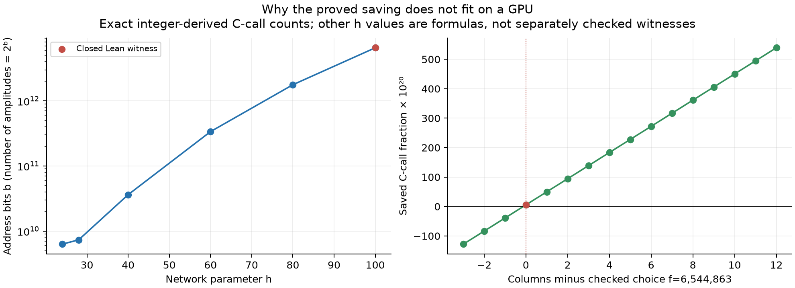
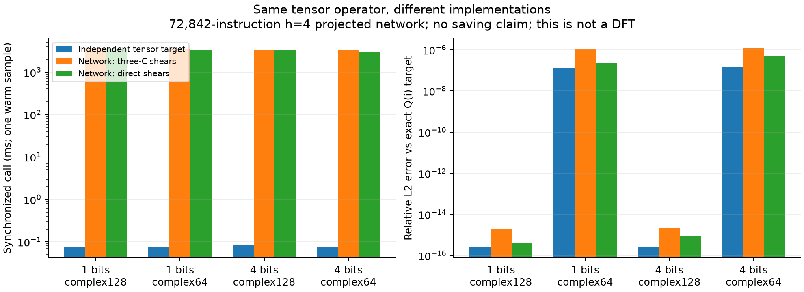
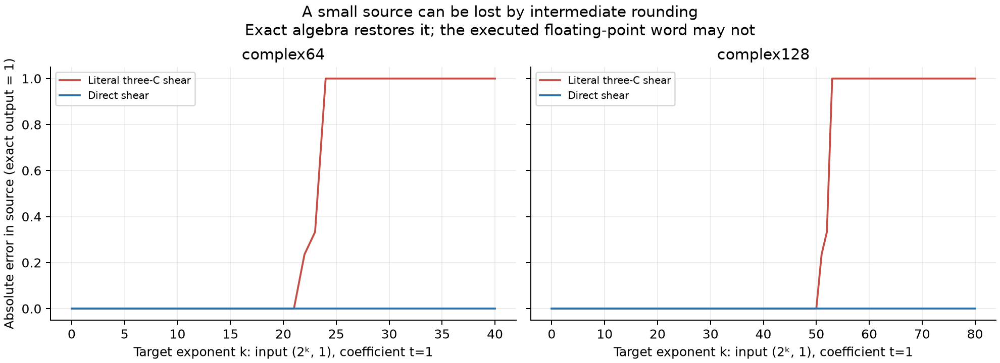
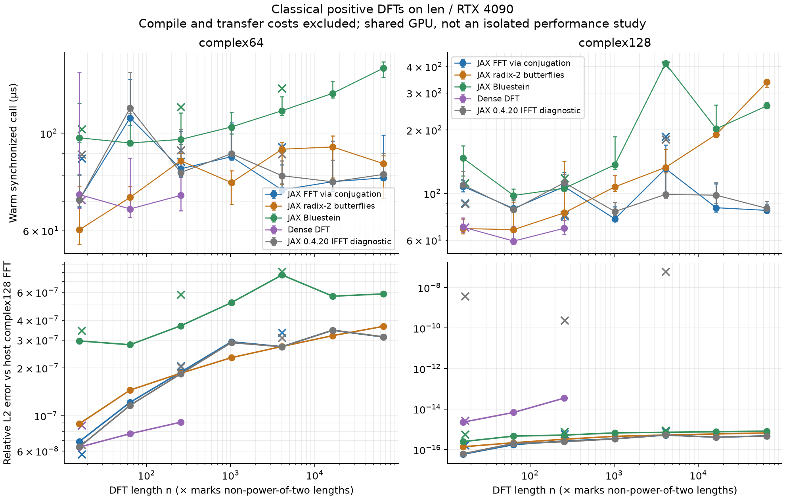
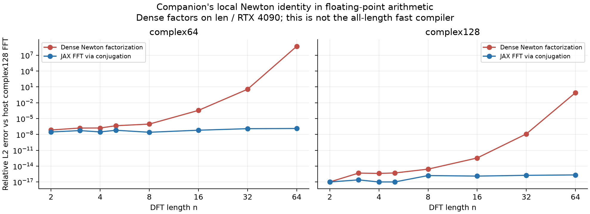

# Replication and numerical investigation

The original exact theorem is reproduced in Lean. The JAX work executes
feasible circuit components and projected networks on CUDA, then compares
classical implementations of the actual DFT. It does not execute the enormous
saving witness or establish a practical faster Fourier algorithm.

## The experiment contract

| Layer | Success condition | Reference |
| --- | --- | --- |
| Original proof | Pinned original theorem builds with permitted axiom closure | Unmodified upstream Lean source |
| Constructive seed | The same literal word has both the tensor identity and strict C-call saving | `ExplicitSeed.word_matrix`, `word_calls`, `word_saves`, `main` |
| JAX circuit | Every opcode and complete small dirty network agrees within stated floating tolerance | Exact Gaussian-rational interpreter and independent projected Walsh spectrum |
| JAX DFT | Positive, unnormalized transform agrees with an independent dense DFT at small sizes | Dense complex128 matrix; host complex128 FFT at larger sizes |
| Stability | Record both overall error and preservation of a small source | Exact source output 1 in a shear |
| Performance | Synchronize results; separate first call and warm calls | Same input, precision, device, sign and normalization |

The two papers support different claims. [Finite tensor savings and exact
Fourier circuits](https://github.com/openai/math/blob/adc7f1241b42e322a6451854ab7e4b4c146bf78a/preprints/Finite-tensor-savings-and-exact-Fourier-circuits-September-25-2026/main.pdf)
proves the subsequential statement formalized in `math/lean/docs/130.md`:
for every positive constant and cutoff, some larger DFT has an exact circuit
below that constant times `n log₂ n`. The circuit gates use exact complex
arithmetic and predetermined scalars. This has no floating-point or
all-length uniform runtime conclusion.

[An explicit power saving for the exact discrete Fourier
transform](https://github.com/openai/math/blob/adc7f1241b42e322a6451854ab7e4b4c146bf78a/preprints/An-explicit-power-saving-for-the-exact-discrete-Fourier-transform-September-25-2026/main.pdf)
supplies the explicit incidence construction used by our closed seed. Its
stronger single-algorithm theorem remains unfinished in this repository. That
formalization is preserved while this investigation focuses on replication
and numerical understanding.

Open [the paper playground](../notebooks/paper-playground.ipynb) to change both
papers' parameters, precision, target amplitude and local transform sizes.
The default cells run on CPU in about two seconds; choose `DEVICE="gpu"` in
a fresh CUDA kernel. Full projected replay is optional and disabled by default.
All 11 default code cells were also executed on len's CUDA backend. The notebook
selects `cuda` explicitly for that device choice to avoid JAX 0.4.20 trying
to initialize an unavailable ROCm backend. Local verification also executed
the notebook through an actual Jupyter kernel.

The accompanying explorer switches between exact seed counts and the
companion's asymptotic bound shape. The latter sets an unknown multiplicative
constant to one for illustration; it cannot predict an FFT crossover.

## Read the plots in this order



The horizontal problem size in the first panel is **address bits**, not
floating-point precision: an array has `2^b` amplitudes. The red point is the
closed `h=100` witness. Other points are independently recomputed combinatorial
formulas, not additional checked Lean witnesses.

Let `Δ` be the bank dimensions avoided, `H` the pointwise three-C overhead,
`f` the number of columns, and `W*` the padded role count. After role-axis
transforms, `b=mf+r` and

```text
ordinary C calls = W* b · 2^(mf−1)
constructed C calls = (S f + r W* + 2H) · 2^(mf−1)
S = W* m − Δ
saved fraction = (Δ f − 2H) / (W* b)
```

Padding matters: using the unpadded residual count would overstate saving.
The checked choice `f=6,544,863` is the first integer giving positive margin.
Its saved fraction is about `5.48194656e−20`; the preceding column count fails.
These ratios are computed as integer fractions before conversion for plotting.
Plotting `constructed/ordinary` directly in FP64 rounds this seed's ratio to 1.
The Lean proof uses exact arithmetic throughout.



The network does repeated scalar exchanges and directional transforms across
roles. Its cancellation identities let it replace some ordinary directions
by shared work; many columns amortize the scalar overhead. Here we execute all
72,842 `h=4` instructions, including initially nonzero auxiliary and padded
roles, with only 1 or 4 address bits. The plot uses seeded random inputs,
treating each supplied binary float as an exact Gaussian rational for the
reference. A separate dyadic control returned exactly matching floating
outputs in every tested case; it is also retained. This is an algebraic projection of the
construction. It has no saving claim: `h=4` has negative dimension margin.

The independent target uses Walsh transforms and the phase
`i^(sum_j parity(image_j & frequency))`, followed by the role-axis tensor.
It does not execute the network or shear compiler. A random projected target
generally differs from both ordinary `C^⊗bits` and a DFT. Its timing therefore
belongs in this same-operator panel, not on the DFT plot.



The exact shear sends `(target,source)` to `(target+source,source)`.
Three C calls interspersed with scalar multiplications implement the same
map exactly. With input `(2^k,1)`, intermediate rounding can erase information
needed to restore source 1. Overall relative L2 error can hide complete loss
of that small source beside the large target. The direct shear preserves its
source by construction.

The executed JAX word first loses the entire source at target exponent 24 in
complex64 and 53 in complex128. Its overall relative L2 error at those points
is only about `8.43e-8` and `1.11e-16`, respectively.

`C` itself is unitary, with eigenvalues 1 and i. The concern is the
intermediate scaling and cancellation in the compiled word. JAX/XLA may fuse
arithmetic, so the observed rounding need not match an unfused interpreter
or the earlier CuPy results. Failure in one implementation does not contradict
the exact theorem or establish instability of every permitted saving circuit.



These methods all compute `Σ_j x[j] exp(+2πi j k/n)`. The built-in baseline is
`conj(jnp.fft.fft(conj(x)))`, supplying that sign without inverse normalization.
The mathematically equivalent
[`jnp.fft.ifft(..., norm="forward")`](https://docs.jax.dev/en/latest/_autosummary/jax.numpy.fft.ifft.html)
is retained as a separate diagnostic. On the installed JAX 0.4.20 CUDA build,
its complex128 error at non-power-of-two lengths agrees with a binary32
reciprocal normalization factor. The conjugated forward FFT removes that
observed error. This explanation is inferred from constant-input controls,
not a full audit of XLA internals. Current local JAX 0.11.2 does not reproduce
it. The failed first benchmark receipt is retained, and the diagnostic's
accuracy failures are recorded explicitly rather than loosening tolerance.
Radix-2 uses
explicit butterflies with no FFT library calls. Bluestein reduces arbitrary
lengths to a padded chirp convolution using two FFTs and one inverse FFT.
The dense implementation provides a small-size direct comparison.

Warm samples call `block_until_ready()` as required by [JAX's benchmarking
guide](https://docs.jax.dev/en/latest/benchmarking.html). First-call time,
including JIT compilation, is retained separately in the JSON. Source/factory
preparation and transfers are excluded from warm timing. The GPU is shared;
these exploratory samples are not an isolated performance study. The circuit
panel uses one warm sample per case because of its long instruction tape.
The FFT panel uses seven samples per case, retaining their full range.

At length 65,536 in complex128, the measured median warm calls were about
83 µs for JAX FFT, 260 µs for Bluestein and 337 µs for explicit radix-two.
Launch overhead dominates many of these small experiments; these timings
do not establish a saving circuit's runtime.



The companion's local identity is `F = N diag(diag(N))⁻¹ Nᵀ`, with ordinary
transpose and the same positive Fourier sign. The entries are computed from
the paper's explicit products, without calling an FFT. This dense experiment
costs O(n²); it does not implement the shallow Toeplitz circuit or global
uniform scheduler. Its identity has exact component proofs in
`UniformNewton.lean`; 48 transitive axiom closures were checked again here.

The CUDA sweep agrees at the tested small lengths through 8. At length 32,
the seeded random relative L2 error reaches about `3.61` in complex64 and
`1.25e-8` in complex128; at length 64 it reaches `4.86e8` and `0.809`.
Large factor entries and cancellation explain why an exact factorization
can fail numerically. The reference FFT stays accurate on the same inputs.
Larger Newton cases are explicitly recorded as diagnostics, with their
accuracy failures visible; they are not counted as stable implementations.

The full local Python suite passed 98 tests. The CUDA checks passed 19
backend/FFT tests and 6 Newton tests in separate jobs. The benchmark receipts
contain 82 FFT cases, 24 projected cases across dyadic and random inputs,
244 shear observations and 32 Newton/FFT comparisons. All required accuracy
checks pass; the retained IFFT and larger Newton diagnostics show the
exceptions described above.

## Reproduction

From the repository root:

```sh
bash scripts/verify-lean.sh --skip-cache
bash scripts/verify-construction.sh
uv pip install --python .venv/bin/python '.[jax,research]'
.venv/bin/python -m unittest discover -s tests -p 'test_jax_*.py' -v
```

On len, the isolated staging directory is
`/home/xangma/repos/exact-fourier-jax`. The runner reuses the existing
Python 3.11.9 / JAX 0.4.20 CUDA environment read-only, disables GPU
preallocation and bounds each job with `timeout`. It never installs into the
shared environment. Local CPU checks use Python 3.14.6 / JAX 0.11.2.

```sh
bash scripts/run-jax-on-len.sh tests
bash scripts/run-jax-on-len.sh fft
bash scripts/run-jax-on-len.sh normalization
bash scripts/run-jax-on-len.sh shear
bash scripts/run-jax-on-len.sh projection
bash scripts/run-jax-on-len.sh newton
bash scripts/run-jax-on-len.sh notebook
```

Retained GPU results, source hashes, proof receipts and exact counting data
are under [verification/jax-replication](../verification/jax-replication).
Historical benchmark source snapshots accompany the failed first FFT run,
dyadic run and random projected run, so each receipt's source hash resolves
even after the driver gained the Newton suite.
Render their PNG, SVG and PDF figures with:

```sh
.venv/bin/python scripts/plot-jax-replication.py \
  --input-dir verification/jax-replication --output-dir docs/assets
```

The next numerical investigation is to capture intermediate magnitude and
source error through each three-C step, then test power-of-two normalization
on the same inputs. The next formal milestone is the stronger uniform
algorithm's complete preparation, scheduling and Fourier transfer; none of
these small GPU plots closes that theorem.
